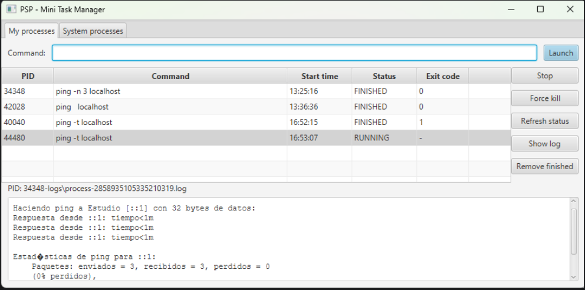

## Jose Patricio Galán Rodríguez

#### O.S. Windows 11 Pro
#### Java version: openjdk-26.0.2.1



| Command | Action | Expected result | Actual result |
|---|---|---|---|
| `ping -n 3 localhost` | Launch and wait without pressing *Refresh status* | Process ends by itself after ~3 s with exit code 0 | Row changed to FINISHED after ~3 s, exit code 0 |
| `ping -t localhost` | Launch, then **Stop** (`destroy()`) | Status FINISHED, exit code different from 0 | FINISHED, exit code 1 |
| `ping -t localhost` | Launch, then **Force kill** (`destroyForcibly()`) | Status FINISHED, exit code different from 0 | FINISHED, exit code 1 |
| `abc123` | Launch | Error dialog, no new row in the table | Dialog: `Cannot run program "abc123": CreateProcess error=2`, no row added |
| `calc.exe` (twice) | Launch | Launcher: process ends immediately | Row FINISHED right away, Calculator window stayed open (different PID) |
| `ping -t localhost` | **Show log** several times | Log content grows each time | Content grew on every click; the label kept the same PID and path |
| `java -version` | Launch, then **Show log** | Process ends immediately; log has content even though the output goes to stderr | FINISHED, log contains the version text (stderr merged into stdout) |
| `ping -t localhost` + finished rows | **Remove finished** | Only FINISHED rows are removed | Only FINISHED rows removed, RUNNING row kept |
| `ping -t localhost` | Close the window, answer **No** | Process keeps running (orphan) | Still alive, checked with `tasklist \| findstr /i ping` |
| `ping -t localhost` | Close the window, answer **Yes** | Process is stopped before closing | Process no longer listed in `tasklist` |
| Filter `java` (System processes tab) | **Refresh** | List of Java-related processes sorted by PID, with a count | 4 processes listed (2 `java.exe` with the same parent PID, plus 2 Java Update processes) |
| Filter `java` | Select the task manager itself and **Kill selected** | Action blocked with a warning | Warning: "You cannot kill the task manager itself" |
| `ping` (System processes tab) | Select it and **Kill selected** | Confirmation dialog, then it disappears from the list | Confirmation shown, process removed after refresh |


### Which exit code do you get when you stop a ping with Stop? And with Force kill? Why are they different? (If you use Windows, explain why they are the same.)
On Windows, both **Stop** and **Force kill** gave exit code **1**, so they are the same. On Windows, `destroy()` and `destroyForcibly()` both end up calling the operating system's `TerminateProcess`, which ends the process immediately.
### What happens if you write the whole command as one string, new ProcessBuilder("ping localhost")? Why?
It fails with an `IOException` (`CreateProcess error=2`, file not found). `ProcessBuilder` does not split the text by spaces: the first element is the program name and every argument must be a separate element. With a single string, the operating system looks for an executable named `ping localhost`which does not exist. `CommandLine.split` avoids this by converting the text into `["ping", "localhost"]`.
### Launch calc.exe (Windows), open -a Calculator (macOS) or gnome-calculator twice (Linux) and look at its status. What has happened? On macOS, also launch open -W -a Chess and press Stop: why does the window stay open?
The row became **FINISHED** immediately, but the Calculator window stayed open. `calc.exe` is a *launcher*: it starts the real Calculator (`CalculatorApp.exe`, a different process with a different PID) and then ends.
### Why do we redirect the output to a file instead of reading it with inputReader() in the controller?
The controller runs in the JavaFX thread, the one that draws the window. Reading the output of a process that never ends (such as `ping -t`) would block that thread waiting for more data, and the window would freeze until the process finished. The same applies to `waitFor()`. Redirecting the output to a file lets the operating system write it without the application having to read anything, and the file is read only when the user clicks **Show log**.
Redirecting also avoids another problem: if the output of a process is sent to a pipe that nobody reads, the pipe buffer can fill up and the process may block. Merging stderr into stdout with `redirectErrorStream(true)` makes sure that programs that write to stderr, like `java -version`, also appear in the same log.
### Close the application with a process running and answer No to the question. Is the process still running? How can you check it?
Yes, it keeps running as an orphan process, because closing the parent application does not stop its child processes by itself. I checked it from a terminal with:
```
tasklist | findstr /i ping
```
